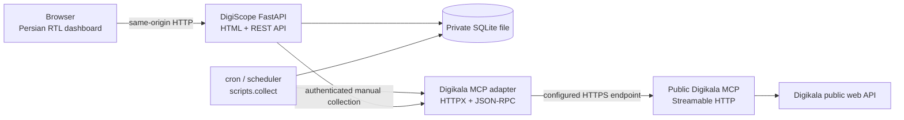
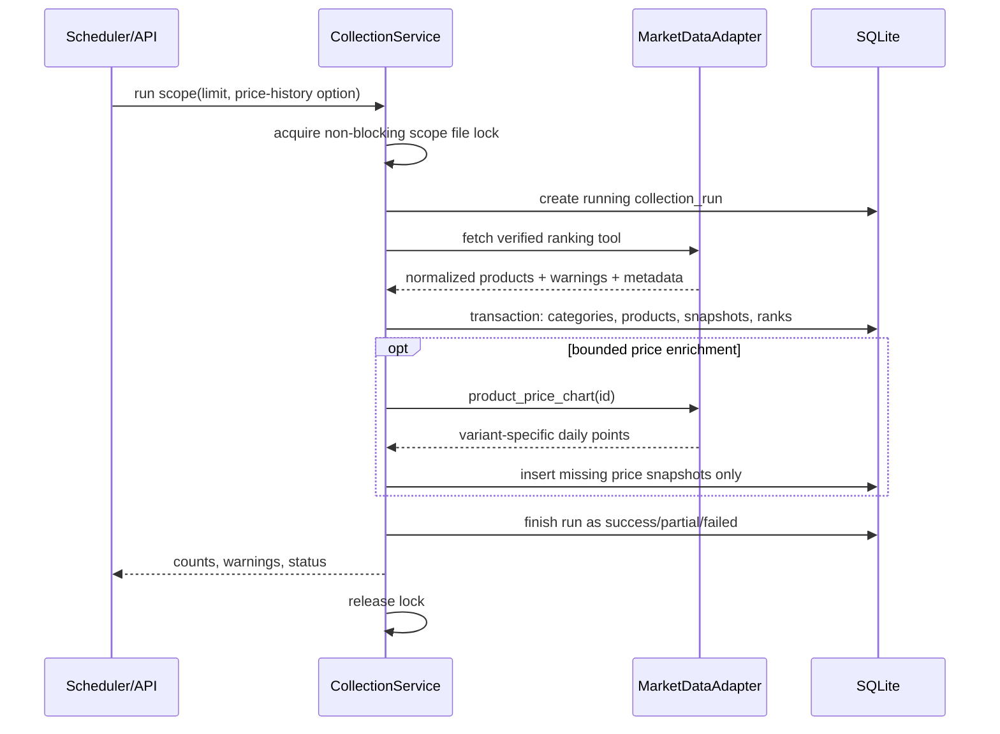
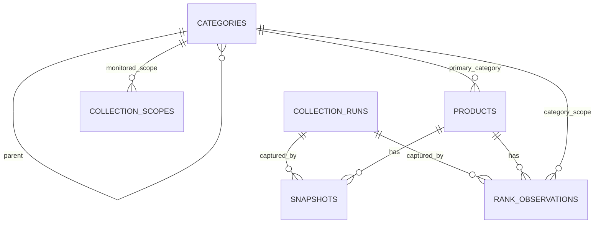

# DigiScope architecture

This document describes the DigiScope application at version `0.1.x`. For the
separate upstream MCP service, see the inspected
[MCP integration report](MCP_INTEGRATION_REPORT.md) and
[tool reference](tools.md).

## Design goals

1. Preserve observed facts without inventing historical ranks or sales values.
2. Keep the MVP deployable as one FastAPI application plus one cron command.
3. Isolate the MCP protocol behind a replaceable adapter.
4. Make incomplete history and collection failures visible to API and UI users.
5. Keep dependencies and operating requirements small enough for a single host.

## System context



The browser never calls localhost services or the MCP endpoint. All browser
requests use relative same-origin URLs. DigiScope does not enable CORS.

## Runtime topology

DigiScope has two executable roles that share the same code and SQLite database:

- **Web role:** one Uvicorn/FastAPI process serving HTML, static assets, OpenAPI,
  read APIs, health checks, and authenticated manual collection.
- **Collection role:** `python -m scripts.collect`, normally invoked by cron. It
  exits after processing the selected enabled scopes.

There is deliberately no in-process scheduler. That avoids each web worker
starting a duplicate scheduler after reloads or host restarts. The SQLite MVP is
intended for one web worker and one scheduler host.

## Application modules

```text
app/main.py                    app factory, lifespan, middleware, health
app/config.py                  validated environment settings
app/database.py                engine/session setup and SQLite pragmas
app/api/                       REST route handlers
app/schemas/                   Pydantic request/response contracts
app/models/                    SQLAlchemy persistent entities
app/services/product_service   category/product upserts
app/services/collection_service collection transaction and locking workflow
app/services/analytics_service coverage, ranking, trend, detail read models
app/mcp/client.py              Streamable HTTP and JSON-RPC transport
app/mcp/adapter.py             market-data interface and Digikala tool mapping
app/mcp/normalizer.py          strict upstream-to-domain normalization
app/templates + app/static     Persian dashboard and vendored browser assets
```

Route handlers contain validation and orchestration only. Collection, persistence,
and analytics rules live in services. Tool-specific fields do not leak directly
into routes or templates.

## MCP boundary

`MarketDataAdapter` is the application boundary. The production
`DigikalaMCPAdapter` and deterministic `MockMCPAdapter` implement the same two
operations:

- fetch a ranking batch for a global or category scope;
- fetch verified short price history for a numeric Digikala product ID.

The HTTP client:

1. sends `initialize` with protocol `2024-11-05`;
2. records server information and an optional `Mcp-Session-Id`;
3. sends `notifications/initialized`;
4. calls tools through JSON-RPC `tools/call`;
5. accepts direct JSON or SSE `data:` events;
6. prefers standard `structuredContent` and otherwise JSON-decodes text content;
7. handles HTTP, timeout, JSON-RPC, and MCP tool errors separately;
8. retries only transient failures within configured bounds and honours
   `Retry-After` up to the configured safety ceiling.

The endpoint URL comes only from configuration. API callers cannot select a tool
or outbound URL.

## Collection sequence



A ranking batch is persisted in a controlled transaction. An optional price
history failure changes the run to `partial` but does not delete an already saved
ranking. A ranking failure records a failed run and leaves previous history
untouched.

## Stable identity and normalization

The preferred identity is the upstream numeric product ID. If it is absent, the
normalizer accepts a deterministic fallback only from a verified canonical
Digikala `dkp-...` URL. It never uses a mutable title as identity.

Normalization rules include:

- invalid or negative prices remain absent rather than being coerced;
- ratings are accepted only in `0..5` and discounts only in `0..100`;
- missing stock state remains null rather than becoming out of stock;
- only verified Digikala product links are stored;
- duplicate product IDs in one batch are skipped with a warning;
- category page offsets respect `total_slots` so missing slots do not silently
  compress observed positions;
- price-chart points retain variant, seller, warranty, original day, and Toman
  metadata and never become ranks.

## Persistence model



- `products` contains stable identity and relatively static metadata.
- `categories` supports a nullable parent relationship.
- `snapshots` contains observed nullable product attributes and imported price
  points. A product/time/source/variant uniqueness constraint prevents duplicate
  imports.
- `rank_observations` contains scope, ranking method, position, time, and run.
  Per-run product and position constraints prevent duplicate ranks.
- `collection_runs` records lifecycle, counts, duration, safe diagnostics, scope,
  and method.
- `collection_scopes` selects scopes for the no-argument collector and stores
  their expected interval for coverage. Cron owns actual timing; the collector
  does not perform due-time scheduling.

SQLite connections enable foreign keys, a 30-second busy timeout, WAL mode, and
normal synchronous durability. Datetimes are written as UTC. SQLite may return
naive datetime objects, so the read boundary explicitly restores UTC.

## Analytics read path

Current rankings use the most recent successful or usable partial run for the
same scope and method. Historical analytics select actual stored observations
inside a rolling window and group them by stable product ID.

Coverage and trend formulas are specified in
[`data-integrity.md`](data-integrity.md). Analytics responses include their data
basis (`current_observed_ranking` or `stored_observed_ranking_history`) so the UI
and exports cannot silently confuse current and historical data.

## Frontend architecture

The server renders one semantic Persian HTML page. Three small scripts provide:

- `api.js`: centralized same-origin fetch client with timeouts and safe errors;
- `charts.js`: Chart.js lifecycle and rank/price datasets;
- `app.js`: state, filters, pagination, tables, details, collection status, and
  accessible interactions.

No production mock rows are embedded in the page. Demo rows exist only after the
explicit development seed command and are labelled by both API and UI. Dynamic
product text uses `textContent`; external links and images are protocol-checked.

## Concurrency and failure model

- A non-blocking Unix `flock` is keyed by scope and ranking method. It coordinates
  web and cron processes on one shared filesystem.
- SQLite transactions protect each ranking persistence unit.
- Failed runs are retained for observability and excluded from product-absence
  denominators.
- One category can fail while other scope runs succeed; outcomes remain separate.
- The lock is not a distributed lock. Multiple machines require a shared job
  coordinator and a server database before horizontal scaling.

## Trust boundaries

1. **Browser input:** Pydantic/query validation and explicit sort allowlists.
2. **Administrative trigger:** constant-time token comparison plus burst and
   overlap guards.
3. **MCP response:** protocol parsing, schema normalization, safe metadata, and
   no complete payload logging.
4. **Database/static split:** runtime state is outside `app/static` and ignored by
   Git.
5. **External marketplace data:** observable but not guaranteed complete or
   current; the UI displays timestamps and coverage.

See also: [API reference](api.md), [operations](operations.md),
[deployment](deployment.md), [security policy](../SECURITY.md), and
[testing](testing.md).
